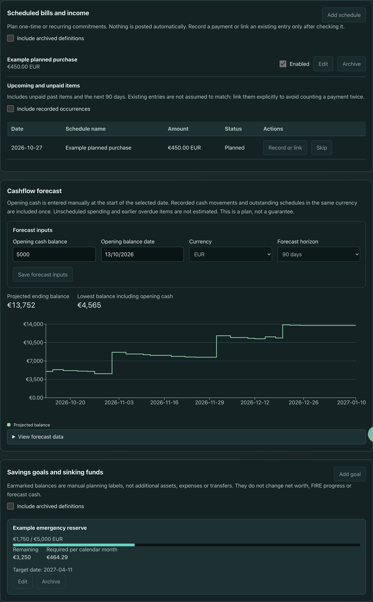

# Cashflow planning

Open **Cashflow Tracker > Planning** for scheduled commitments, a cashflow
forecast, and savings goals. **Rules** configures offline import suggestions.
Home shows up to three upcoming commitments and three active goals, with links
to the complete tools. All new controls use the existing privacy preference.
The public demo shows synthetic plans and does not save or record changes.

## Scheduled bills and income

Use **Add schedule** for a one-time payment or an income/expense recurring every
N days, weeks, months, or years. Choose the amount, currency, classification,
first due date, and optional inclusive last date.

Monthly/yearly dates keep their original anchor. January 31 becomes the last
day of February, then returns to March 31. February 29 returns in the next leap
year. Calendar arithmetic does not shift dates during daylight-saving changes.

Nothing is posted automatically. The upcoming table shows unpaid past items
and the next 90 days, with pages for long lists. You can pause/archive a
definition or skip/restore one occurrence without recording money.

**Record or link** opens a confirmation form:

- Create a transaction using its actual date and amount, which can differ from
  the estimate. It is placed in that actual calendar month.
- Or choose an existing transaction of the same kind and currency. Linking
  leaves its date, amount, description, and category unchanged; it disables
  legacy recurring copying for that entry.

The original due date identifies the occurrence, so recording twice is rejected
and linked payments count only once. Existing transactions are never assumed
to match merely because their amounts or descriptions are similar. Link them
explicitly before recording another payment.

Legacy **Recurring** transactions still copy into a newly opened ledger month.
New confirmed schedule entries do not use that copying mechanism. Existing
unlinked legacy copies remain ledger entries; review/link them explicitly.
Editing or archiving a definition never deletes recorded transaction history.
Deleting a linked actual entry makes its scheduled occurrence pending again.

## Cashflow forecast

Enter **opening cash at the start of the selected date**, its currency, and a
30-, 90-, or 365-day horizon (90 by default). No starting balance is inferred
from your investments or net worth.

Each day combines recorded movements in that window with unrecorded,
unskipped scheduled occurrences of the same currency. Linked actual entries
replace their estimate and use their actual payment date/amount. Negative
balances remain visible; warnings evaluate the complete end-of-day balance,
not an arbitrary order of payments.

The chart has an accessible **View forecast data** table. Wide charts/tables
scroll inside the panel. Privacy mode masks amounts and does not render the
forecast chart, avoiding numeric axes/tooltips.
Saved opening-cash inputs are also hidden until you choose **Show values**.

This is not a complete prediction of spending: unscheduled spending and
overdue items before the opening date are not moved into the forecast or
estimated automatically. Review those obligations separately and update the
opening cash/date when appropriate. Different currencies are never silently
added or converted. Invalid legacy entries are excluded with a warning.
Projections are educational planning, not guarantees or financial advice.

## Savings goals and sinking funds

Create a named target with its currency, target amount, manually earmarked
balance, and optional deadline. For example, a 100-unit target across three
calendar months requires 33.34 per month in a two-decimal currency.

The contribution calculation includes the current and target calendar months
and rounds up to the currency's minor unit (whole units for JPY). A current-month
deadline has one contribution period. An overdue, unfunded deadline has no
invented contribution estimate; revise the date. Without a deadline, no monthly
contribution is estimated.

Overfunding is retained; only the visual progress bar stops at 100%.
**Earmarked balances are labels, not new assets, expenses, or transfers.**
They do not increase net worth/FIRE progress or reduce forecast cash. No money
is automatically allocated between goals. Archive/restore goals as needed.

## Offline categorization rules

Open **Cashflow Tracker > Rules** to create and order rules for document/receipt
import review. Conditions support literal, case-insensitive description
equals/contains, transaction kind, optional currency, and inclusive amount
bounds. Amount bounds require a currency.

The first matching enabled rule wins. Expense rules suggest category and
need/want; income rules suggest source. A matched-rule label appears in the
review row. Manual edits always win. Matched rows are not sent to optional AI
categorization; only unmatched rows can be submitted with the existing
per-action consent. Rules work with AI disabled.

Rules never rewrite saved history, amounts, dates, currencies, or transaction
kinds. They do not run during backup restore. No executable scripts, regex,
automatic learning, bank connectivity, or new external services are introduced.
Document import keeps its existing experimental flag and local OCR boundaries.

Deleting a custom category reassigns affected schedules/rules along with
transactions after the category dialog's confirmation. Unavailable category
references are shown explicitly; fix them before enabling or applying a plan.

## Storage, backups, and recovery

Planning is versioned metadata inside the renderer's encrypted Cashflow
localStorage snapshot. Recording a scheduled transaction updates that complete
snapshot together. Failed writes keep the prior saved snapshot and show an
error; rapid changes are not dropped behind a synchronization lock.

Full JSON backups and Cashflow CSV version 2 include planning, occurrence links,
currencies, recurrence flags, category definitions, global budgets, and
year/month bookkeeping. CSV accepts commas, escaped quotes, and multiline
descriptions. Legacy Cashflow CSV headers remain supported.

When an old backup omits planning, the restore asks whether to keep the current
plans; cancelling stops the import. Referenced custom categories are retained
with those plans. Invalid planning or unresolved enabled category references
are rejected before replacement. Viewing Home, Planning, or Rules does not
seed financial data, create ledger months, or post transactions.

An explicit Settings currency conversion also converts schedule amounts, goal
targets/balances, and opening cash using each item's own currency. Rule-match
currency/amount criteria remain unchanged because they describe source imports,
not display balances.

Cashflow reset and **Clear all data** remove planning with the ledger.
Unsupported/corrupt saved planning is not silently replaced with empty plans:
the app blocks edits and offers backup/restore or an explicit reset.

The local backend separately exposes GET/PUT
`/api/v1/expense-tracker/planning`, scoped by `user_id`. This does **not** make
the renderer backend-authoritative or automatically synchronize its ledger.
Backend planning is part of SQLite backups/encryption. Migration `0006` adds
the planning document and transaction linkage; rolling it back removes those
new fields but preserves recorded amounts/history. Back up before rollback.
