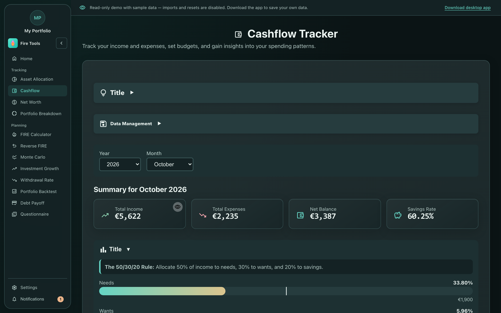

# Expense tracker

A lightweight ledger for monthly cash flow. Use it to figure out your *real*
annual expenses (the number that drives the FIRE target) instead of guessing.

## How to use it

1. **Add categories** (e.g. *Rent*, *Groceries*, *Transport*, *Travel*) under
   Settings → Categories, or accept the defaults.
2. **Add a transaction**: pick a date, category, currency and amount; the
   currency conversion is optional.
3. The ledger groups transactions by month and shows totals per category.

## Reading analytics

Open **Analytics** and choose a month, quarter or year. Category pies and trends
use the same muted colors and respect your category color overrides. Legends
sit outside the plot so long category lists do not crop the chart. On a small
screen, scroll the detailed breakdown table horizontally instead of the whole
page.

The **Expense statistics** panel covers the complete saved history, including
archived years:

- **Expenses year to date** totals actual expense dates from January 1 through
  today. Its monthly average divides by the elapsed calendar months, including
  empty months, not just months with entries.
- **Yearly expenses** plots totals per year and their yearly average, including
  zero-spend years between the first and last expense.
- **Custom date range** uses inclusive start/end dates, even across years.
  Totals and monthly/yearly averages update with the chosen range.

The historical monthly average covers the first through last recorded expense
month. Partial months/years count as one calendar period and missing periods
count as zero; these are not annualised forecasts. Statistics are filtered by
currency instead of adding or silently converting different currencies.
Invalid legacy amounts/dates are excluded with a visible warning.
Use **View statistics data** for the accessible table; wide history charts
scroll locally rather than shrinking their labels. Privacy mode hides the
displayed values, including chart axes, tooltips and table data.

## Importing from your bank

Use **Import documents** to upload a bank statement or receipt photos, or take
a receipt photo. Fire Tools includes lightweight
extractors for a handful of common European bank PDF layouts (see
[`docs/pdf-import.md`](https://github.com/fire-tools-inc/app/blob/main/docs/pdf-import.md) for the supported list and how to
contribute one). Imported rows land in a staging table where you can map them
to categories before committing.

Select **LiteParse + OCR** as an alternative to PDF.js for scanned PDFs and
photos. It runs on the configured local backend, including the desktop's
embedded backend, and retains photo originals in the **Receipt inbox** before
parsing. Phone pairing opens a separate, short-lived upload-only Wi-Fi
listener; an existing HTTPS tunnel is optional. AI categorization supports
OpenAI-compatible local model endpoints with no mandatory key.

## Linking to the FIRE calculator

The bottom of the page shows the **annualised expenses** derived from the
last 12 months of entries. Use that number as the *Annual expenses* input in
the [FIRE calculator](./fire-calculator.md) to make your projection match
reality.
