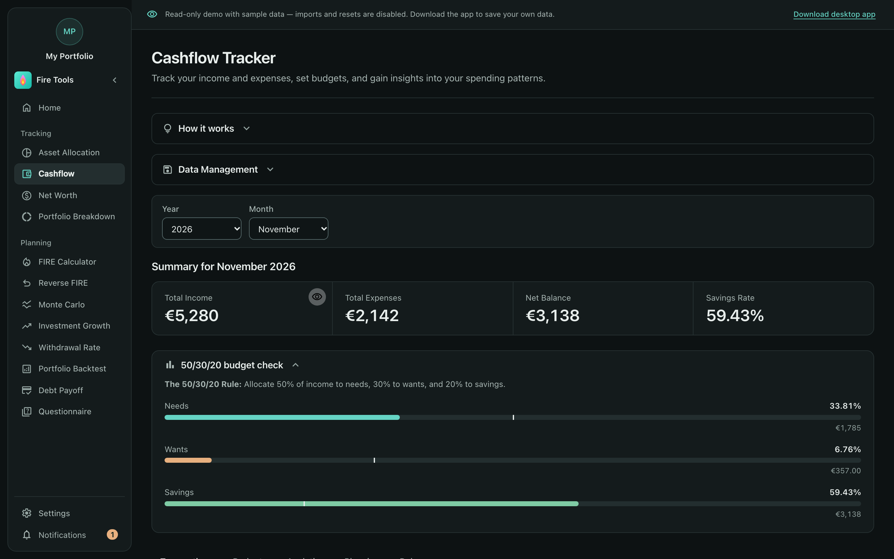
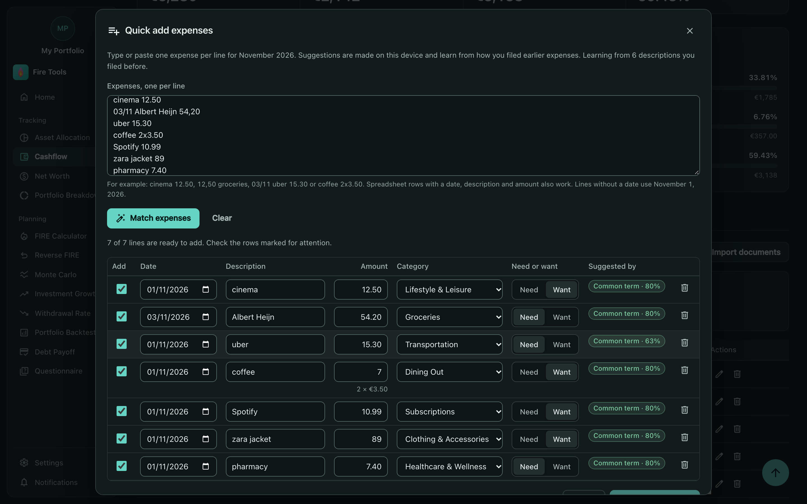
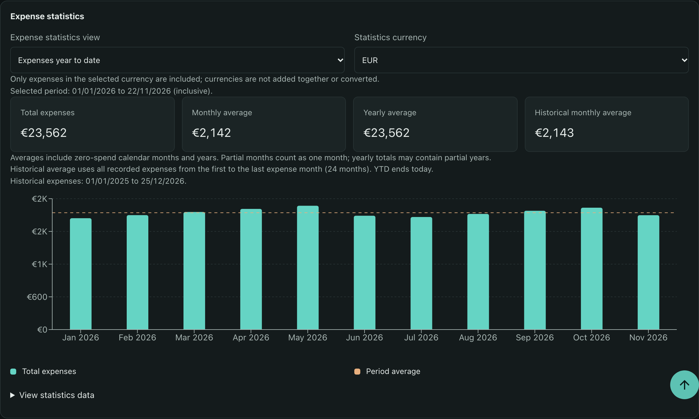

# Expense tracker

A lightweight ledger for monthly cash flow. Use it to figure out your *real*
annual expenses (the number that drives the FIRE target) instead of guessing.



## How to use it

1. **Add categories** (e.g. *Rent*, *Groceries*, *Transport*, *Travel*) under
   Settings → Categories, or accept the defaults.
2. **Add a transaction**: pick a date, category, currency and amount; the
   currency conversion is optional.
3. The ledger groups transactions by month and shows totals per category.

### Recurring and repeated expenses

Turn on **Recurring Transaction** for bills you pay every month (rent,
utilities, insurance). When you open a new month, recurring entries from the
previous month are copied into it.

For a fixed price paid a varying number of times, such as lessons or classes,
turn on **Same amount several times** and enter the amount each time and how
many times. The total is calculated for you and the list shows it as, for
example, *€45.00 × 2*. Combined with **Recurring Transaction**, next month's
copy keeps the price, so you only change the number of times. CSV exports
include the `UnitAmount` and `Quantity` columns.

### Built-in categories

The built-in categories are No Category, Housing, Utilities & Bills,
Groceries, Dining Out, Transportation, Healthcare & Wellness, Personal Care,
Insurance, Debt Payments, Education, Business & Fees, Shopping, Clothing &
Accessories, Electronics & Tech, Entertainment, Lifestyle & Leisure, Music,
Hobbies & Collectibles, Travel & Holidays, Subscriptions, Gifts & Donations and
Other. Each category only suggests Need or Want; you can change it on every
expense. Rename, recolor or add categories in the category manager.

The former **Fees** category is now part of **Business & Fees** and
**Holidays** is part of **Travel & Holidays**. Saved data, backups, CSV and
spreadsheet imports, planning schedules and import rules are converted
automatically. When a month had budgets for both the old and the new
category, the amounts are added together (when they use the same currency).
A custom name or color on the retired category is dropped; the surviving
category keeps its own.

### Quick add: paste a month of expenses



Select **Paste expenses** next to **Add Expense** to log many expenses at
once for the selected month. Type or paste one expense per line, for example:

```text
cinema 12.50
12,50 groceries
€ 54.20 supermarket
03/11 uber 15.30
2026-11-03 train 23.10
coffee 2x3.50
```

Amounts can come before or after the description, with dot or comma decimals,
thousands separators and a currency symbol or code. A line can start with a
day (`3 uber 15.30`), a day and month (`03/11`) or a full date. Lines without
a date use the first day of the selected month, the same default as **Add
Expense**. `2x3.50` records the same price paid several times. Rows copied
from a spreadsheet (tab, semicolon or comma separated) work too, and a header
row is skipped. A line that cannot be read, such as one without an amount or
with a date outside the month, stays in the review table with an explanation
so you can fix it instead of losing it.

Select **Match expenses** to review the rows. Each row gets a category and a
Need/Want suggestion:

1. Your enabled **import rules** always win.
2. Otherwise Fire Tools compares the description with every expense you filed
   before (BM25 text matching) and with a small built-in list of common words
   and well-known shops in English, Italian, German, French and Spanish. Your
   own history counts more than the built-in list, so if you always file a
   shop under a particular category, that category is suggested.
3. Rows with low confidence are highlighted. The **Suggested by** column shows
   whether a suggestion came from a rule, your history, a common term or AI.

You can change the date, description, amount, category and Need/Want of every
row, untick rows you do not want, or remove them. **Add N expenses** saves the
ticked rows into the selected month. Matching runs entirely on this device; it
learns from your saved expenses and nothing is uploaded.

**Improve with AI** appears only when AI features are enabled and a model is
configured in Settings. After you confirm, only the descriptions, amounts and
currencies of the rows that are not already set by a rule or by you are sent
to the configured model; dates and your expense history stay on this device.
If the model fails, your local suggestions are kept. The web demo is read-only,
so it can match expenses but not save them.

### Guided month log

**Log <month>** on the dashboard walks through a month's income, expenses,
investments and pensions in one place. Its income and expense steps write to
this tracker; this page remains the place for edits, budgets and imports. See
[Log month](./homepage.md#log-month).

## Planning ahead

**Planning** adds scheduled income/bills, explicit record/link confirmation,
30/90/365-day cash forecasts and manually funded savings goals. **Rules** adds
offline categorization suggestions to the document-import review. These do
not post money automatically or count reserved goal balances as assets.
See the [cashflow planning guide](./cashflow-planning.md) for accounting
assumptions, privacy, category lifecycle and backup/restore details.

## Reading analytics

Open **Analytics** and choose a month, quarter or year. Category pies and trends
use the same muted colors and respect your category color overrides. Legends
sit outside the plot so long category lists do not crop the chart. On a small
screen, scroll the detailed breakdown table horizontally instead of the whole
page.

The **Expense statistics** panel covers the complete saved history, including
archived years:



- **Expenses year to date** totals actual expense dates from January 1 through
  today. Its monthly average divides by the elapsed calendar months, including
  empty months, not just months with entries.
- **Yearly expenses** plots totals per year and their yearly average, including
  zero-spend years between the first and last expense.
- **Custom date range** uses inclusive start/end dates, even across years.
  Totals and monthly/yearly averages update with the chosen range.

The historical monthly average covers the first through last recorded expense
month. Partial months/years count as one calendar period and missing periods
count as zero; these are not annualised forecasts. Statistics are filtered by
currency instead of adding or silently converting different currencies.
Invalid legacy amounts/dates are excluded with a visible warning.
Use **View statistics data** for the accessible table; wide history charts
scroll locally rather than shrinking their labels. Privacy mode hides the
displayed values, including chart axes, tooltips and table data.

## Importing from your bank

Use **Import documents** to upload a bank statement or receipt photos, or take
a receipt photo. Fire Tools includes lightweight
extractors for a handful of common European bank PDF layouts (see
[`docs/pdf-import.md`](https://github.com/fire-tools-inc/app/blob/main/docs/pdf-import.md) for the supported list and how to
contribute one). Imported rows land in a staging table where you can map them
to categories before committing.

Select **LiteParse + OCR** as an alternative to PDF.js for scanned PDFs and
photos. It runs on the configured local backend, including the desktop's
embedded backend, and retains photo originals in the **Receipt inbox** before
parsing. Phone pairing opens a separate, short-lived upload-only Wi-Fi
listener; an existing HTTPS tunnel is optional. AI categorization works with
local models (no key needed) and hosted providers; see
[AI features](./settings.md#ai-features).

## Importing a yearly expenses spreadsheet

Already track spending in a spreadsheet with one sheet per month? Use
**Data Management > Import expenses (XLSX)** to bring in a whole year, or
**Download expenses template** to start one. See
[Yearly expenses workbook](./spreadsheet-import.md#yearly-expenses-workbook).

## Linking to the FIRE calculator

The bottom of the page shows the **annualised expenses** derived from the
last 12 months of entries. Use that number as the *Annual expenses* input in
the [FIRE calculator](./fire-calculator.md) to make your projection match
reality.
