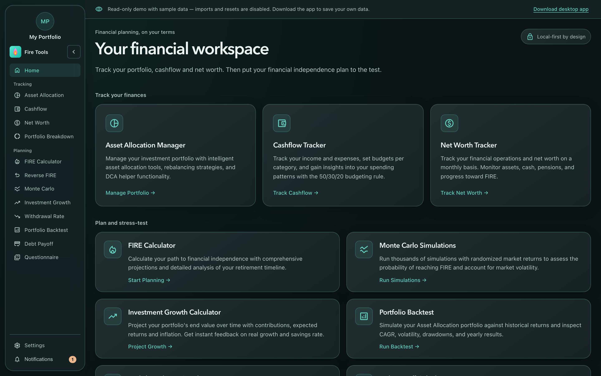

# Homepage & navigation

The homepage is the launchpad for every tool. From here you can dive into the
calculator, the asset allocation manager or any of the trackers.

## What you see

- **Sidebar navigation** — labelled links to every tool stay on the left in
  desktop-sized windows, in a narrow rounded rail. The logo and portfolio
  identity are at the top; Settings and notifications sit below a divider at
  the bottom. The profile is not a duplicate Settings menu.
  Tracking and planning tools are grouped separately, with compact rows and a
  subtle highlight for the current page.
- **Track your finances** — shortcuts to Asset Allocation, Cashflow and Net Worth.
- **Plan and stress-test** — the FIRE calculator, Monte Carlo, Investment Growth,
  Backtest, Withdrawal Rate, Debt Payoff and Questionnaire tools.
- **Dark by default** — the interface stays dark even if your operating system
  uses a light theme. Text and financial values stay opaque; glass effects are
  confined to panels and navigation, with restrained green/teal accents.
- **Language and currency** are remembered across sessions and follow you to
  every tool.

## Tips

- The site is keyboard accessible. Use `Tab` to move between cards and `Enter`
  to open the highlighted tool.
- **Collapse sidebar** switches the desktop rail to icons and gives the page
  more room. Hover an icon for its label; **Expand sidebar** restores the full
  menu. The choice is remembered on this device.
- Below 1,000 pixels, **Menu** opens the sidebar as a drawer. Keyboard focus stays
  inside until you navigate, press `Escape` or dismiss it. Closing returns focus
  to the Menu button. The rest of the page is inactive while the drawer is open.
- **Skip to main content** works in both the browser and desktop app.
- Need to start fresh? Open [Settings](./settings.md) and use **Clear all
  data** — your local store is wiped (SQLite DB on desktop, encrypted cookies
  in browser) and the app reloads empty.
