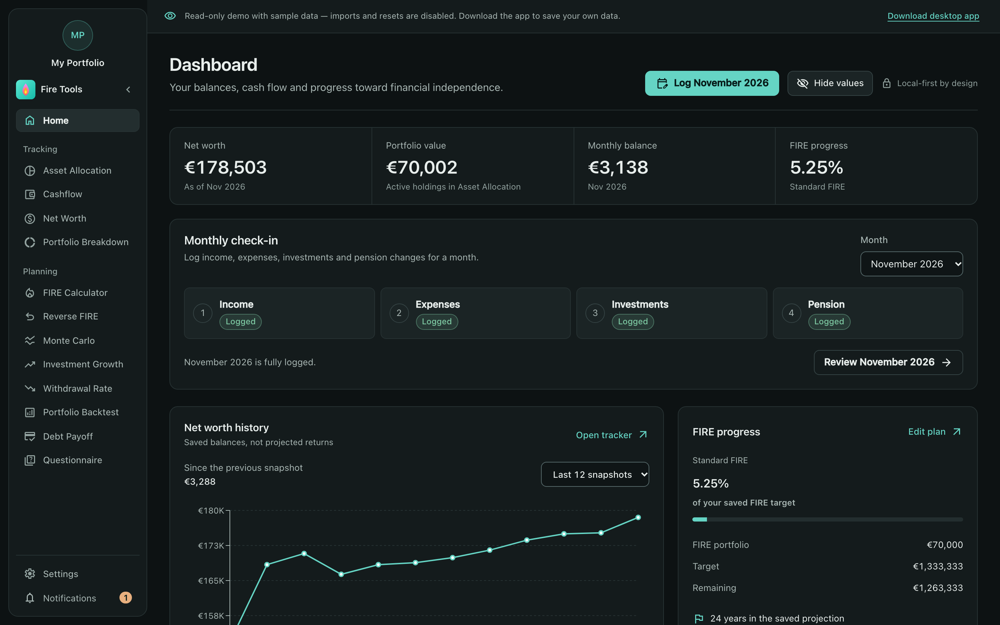
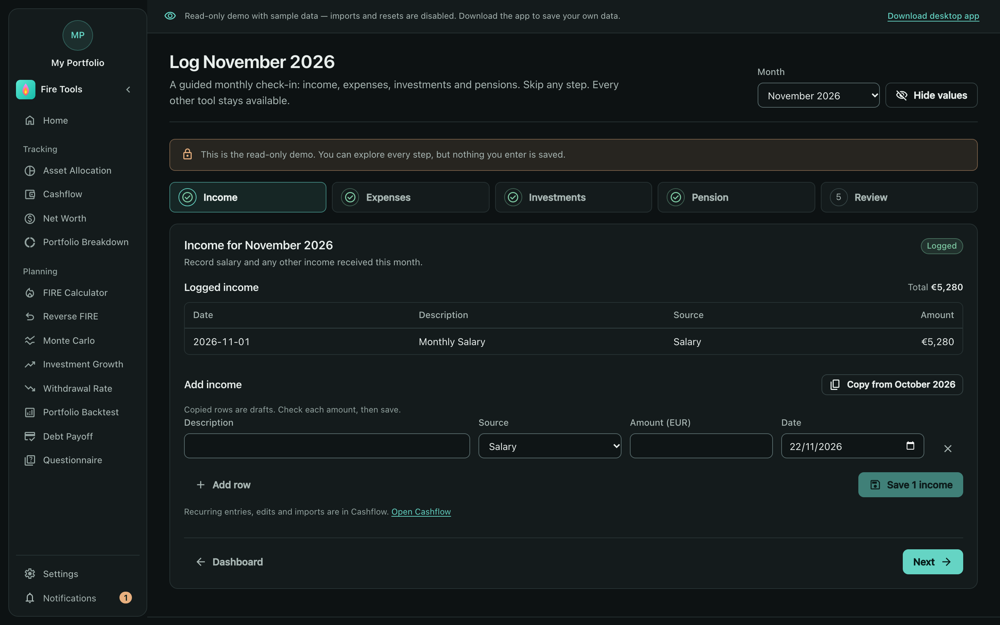

# Dashboard & navigation

Home opens your financial dashboard. The tool catalogue lives on the
[website](https://fire-tools-inc.github.io/app/#features); every tool remains
reachable from the sidebar.

## What you see

- **Sidebar navigation**: labelled links to every tool stay on the left in
  desktop-sized windows, in a narrow rounded rail. The logo and portfolio
  identity are at the top; Settings and notifications sit below a divider at
  the bottom. The profile is not a duplicate Settings menu.
  Tracking and planning tools are grouped separately, with compact rows and a
  subtle highlight for the current page.
- **Net worth history**: your latest recorded snapshot and its change from the
  previous snapshot, with a chart of the last 12 snapshots or all history.
  Pensions follow the tracker's saved inclusion setting; debts, unpaid taxes
  and mortgage balances follow the existing net-worth calculation. Future and
  untouched empty snapshots are not presented as current balances. Recorded
  zero and negative balances remain visible.
- **Asset allocation**: the current active portfolio, using the same class
  colors as the other portfolio views. Excluded holdings are not included.
  The dashboard does not add this balance to net worth or duplicate assets
  across stores. Negative balances remain in the portfolio total; the donut
  uses only positive class balances and normalizes those shares to 100%.
- **Monthly cash flow**: this calendar month's income, expenses, balance and
  savings rate, plus the last six tracked months. A spending deficit stays
  negative. An old selected month is not mistaken for the current month.
- **FIRE progress**: the target and projection from your saved calculator
  inputs, including the selected FIRE variant. If the calculator uses Asset
  Allocation, its inclusion and primary-residence settings still apply.
  Otherwise progress uses the saved calculator balance, not total net worth.
  Percentages can exceed 100%; the visual progress bar stops at the target.
  Projections are not guarantees.
- **No invented data**: missing sections explain what to record and link to
  the relevant tool. Viewing Home does not seed or overwrite financial data.
  The public demo displays the app's existing sample data and stays read-only.
- **Upcoming commitments and savings goals**: compact summaries of the next
  three pending commitments within 30 days and three active manual goals link
  to Cashflow Planning. Reserved goal balances are not added to net worth,
  portfolio totals, FIRE progress or recorded cashflow.
- **Dark by default**: the interface stays dark even if your operating system
  uses a light theme. Surfaces are flat graphite panels with hairline borders;
  teal marks actions, the current page and status, and figures use tabular
  numerals so columns line up.
- **Consistent pages**: every tool opens with the same header (title, short
  description and page actions) and the same page width, so moving between
  tools never shifts the layout.
- **Language and currency** are remembered across sessions and follow you to
  every tool.

## Log month

**Log <month>** in the dashboard header and the **Monthly check-in** card start
an optional, guided month log. Everything else on the dashboard and in the
sidebar works as before; you can skip the log entirely.

1. **Income**: review what is already logged, add rows (description, source,
   amount and a date inside the month) or **Copy from <previous month>**.
   Copied rows are drafts until you save them; incomes recorded from a planning
   schedule are not copied, so record those from Cashflow Planning.
2. **Expenses**: see the month's count, total and top categories, then paste
   or type new expenses in the quick import.
3. **Investments**: if the month has no net worth snapshot yet, **Start from
   <previous month>** copies holdings, cash accounts and pensions, exactly like
   **Start Month Log** in the Net Worth Tracker. Edit shares, prices and
   balances in place; each valid value is saved as you type and compared with
   the previous snapshot. **Fetch month-end prices** is optional and never
   blocks the flow.
4. **Pension**: update current values, see the change since the previous
   snapshot and add a pension. Contributions can still be logged as operations
   in the Net Worth Tracker.
5. **Review**: income, expenses, net balance, savings rate, net worth and its
   change since the previous snapshot. **Finish** returns to the dashboard.

Amounts, shares and prices use the decimal separator chosen in **Settings >
Display**; the other separator is only accepted between groups of three
digits, so `3,200` is 3200 with a dot decimal and an ambiguous `3,2` is
flagged instead of saved.

Every step can be skipped with **Skip**, revisited from the step list or with
**Back**, and links to the full Cashflow or Net Worth page for advanced edits.
The month and step are part of the address, so refreshing or using the
browser's back button keeps your place. Use the **Month** menu to log another
month.

The check-in card derives each step's status from your saved data; it does not
store anything extra. A step is **Logged** when the month has entries,
**Same as last month** when copied holdings or pensions still match the
previous snapshot, and **Nothing to log** when you track no pensions. During
the first ten days of a month the dashboard suggests the previous month if it
is still incomplete, because many people log after month end.

If saving fails, the page keeps what you typed, explains the problem and lets
you try again. The public demo lets you explore every step, but it is
read-only and nothing is saved.

## Tips

- Use `Tab` to reach dashboard actions and sidebar links. **View chart data**
  exposes the figures in a keyboard-scrollable table.
- **Hide values / Show values** follows and saves the same privacy preference
  used by the tools. It hides values visually, not from code or exports.
- Returning from another tool, focusing the app or receiving a storage update
  refreshes the dashboard's saved balances. Each tracker keeps its own currency
  label; the dashboard does not silently convert or relabel amounts.
- **Collapse sidebar** switches the desktop rail to icons and gives the page
  more room. Hover an icon for its label; **Expand sidebar** restores the full
  menu. The choice is remembered on this device.
- Below 1,000 pixels, **Menu** opens the sidebar as a drawer. Keyboard focus stays
  inside until you navigate, press `Escape` or dismiss it. Closing returns focus
  to the Menu button. The rest of the page is inactive while the drawer is open.
- **Skip to main content** works in both the browser and desktop app.
- Need to start fresh? Open [Settings](./settings.md) and use **Clear all
  data** — your local store is wiped (SQLite DB on desktop, encrypted cookies
  in browser) and the app reloads empty.
