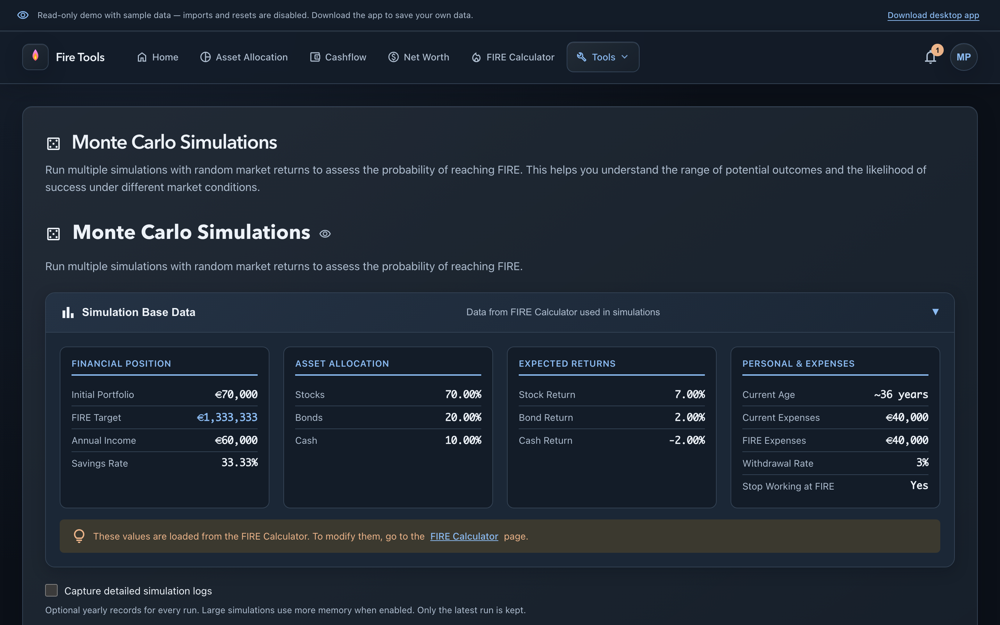

# Monte Carlo simulation

The [FIRE calculator](./fire-calculator.md) projects a single expected path.
Monte Carlo runs the plan repeatedly with randomized annual returns to explore
the range of possible outcomes.

## How to use it

1. Set your financial inputs in the FIRE calculator, then open Monte Carlo.
   **Simulation Base Data** shows the inputs used; these are read-only here.
2. Set stock and bond **volatility**, the standard deviation of annual returns.
   Defaults are 15% for stocks and 5% for bonds.
3. Set the annual **black-swan probability** and loss impact. The defaults are
   2% and a 40% stock loss; bonds receive half that loss during the event.
4. Choose **1,000–100,000 runs**. The simulation runs in a background worker,
   with progress shown while the interface remains usable. **Cancel** stops it.
5. Enable **Capture detailed simulation logs** only when you need yearly records.
   Logs are off by default and limited to **10,000 runs** to control memory use.
   Results still include every run when logs are disabled.

The horizon ends at the maximum age selected in the FIRE calculator, capped at
50 simulated years. Select a maximum age greater than your current age.

## Reading the results

- **Success rate** is the share of runs that reach FIRE, or finish above the
  inflation-adjusted target, without a critical failure. Depletion, an
  unrecovered loss of FIRE, insufficient ending capital or a forced return to
  work can make a run fail.
- **Median years to FIRE** uses successful runs. Zero means FIRE was already
  reached at the start; N/A means there were no successful runs.
- The **years histogram** counts successful runs by time to FIRE, including
  the upper boundary of the distribution.
- **Final portfolio statistics** include depleted portfolios at zero, not
  just surviving portfolios. The median and 10th/90th percentiles summarize
  the full set of outcomes.

The histogram and statistics are prepared in the worker. Increasing the run
count does not send a large list of individual results to the interface.

## Detailed logs

When enabled, yearly records and failure reasons can be downloaded as CSV or
JSON. Only the **latest completed run** is kept, so the records match its
parameters. Logs are temporary and disappear when you leave or refresh the
page; download them if you need a record.

These results are a planning model, not a forecast or a guarantee. A low success
rate or a wide spread of outcomes is a reason to revisit the assumptions,
savings rate, allocation or retirement horizon.
