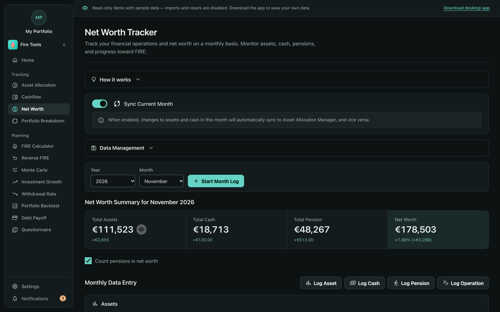

# Net-worth tracker

A timeline of your total net worth over months and years. Plots the trajectory
and shows you how today's reality compares to the
[FIRE calculator](./fire-calculator.md) projection.



## How to use it

1. **Add a snapshot**: pick a date and enter the total value of each tracked
   account (or import via CSV).
2. Repeat at whatever cadence suits you — monthly is plenty.
3. The chart shows your real progression; the dashed line is the projection
   from the FIRE calculator at the same horizon.

## Pensions and net worth

Pensions are always totalled on their own card. **Count pensions in net worth**,
below the summary cards, decides whether they are added to net worth, the
history chart, year-to-date figures and the forecast. Turn it off when pension
rights you track cannot be withdrawn like savings.

## Why bother?

Tracking net worth turns the FIRE plan from a fantasy into a metric. The
projection in the calculator only matters if your actual numbers are at or
above the trend.

## Export / Import

Snapshots round-trip via CSV so you can keep a backup outside the local store
(SQLite on desktop, encrypted cookies in browser). Use the **Export CSV**
button to grab a snapshot of all entries; use **Import CSV** to restore.

To backfill years of history from a spreadsheet, use **Data Management >
Import spreadsheet (XLSX)** or **Download template**. **Import operations
(XLSX)** adds buys, sells and dividends from an investment ledger and sets the
average cost of matching holdings. See
[Spreadsheet import](./spreadsheet-import.md).

## Wealth Flow diagram (Sankey)

Below the historical chart you'll find a **Sankey / flow diagram** that shows
how your total portfolio is composed at the current month's snapshot.

```
Total Portfolio
  ├─ Investments ──► STOCKS, ETF, BONDS, REAL_ESTATE, COMMODITIES, …
  ├─ Cash & Liquidity ──► CHECKING, SAVINGS, MONEY_MARKET, …
  └─ Pension ──► STATE, OCCUPATIONAL, PRIVATE, …  (if pension tracking is on)
```

Each band's width is proportional to the euro value it represents. Hover a
band or node to see the exact amount.

The flow diagram keeps readable labels rather than shrinking them to fit a
phone. In a narrow window, scroll the diagram horizontally; keyboard users can
focus it and use the arrow keys. The diagram grows vertically for larger sets
of asset, cash and pension categories.

**When it won't appear:**

- No snapshot for the current month exists yet, **or**
- The total portfolio value is below 1 (i.e. effectively empty data).

In those cases a friendly placeholder message is shown instead of an empty
chart.

**Pension toggle**: When **Count pensions in net worth** is off, the Pension
branch is hidden from the diagram.

**Negative balances** (e.g. credit-card debt) are excluded because Sankey
diagrams cannot represent negative flows. They still count toward your overall
net worth calculation.
