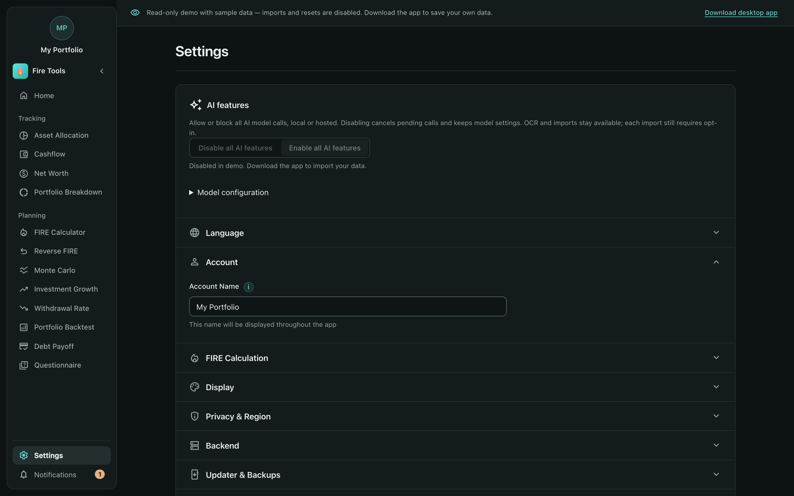

# Settings, language, data management

Everything that controls how Fire Tools looks and behaves lives on this page.

## Search

Type in **Search settings** at the top to find a setting by any word it shows,
such as "decimal", "token" or "backup". Matching sections open and the others
are hidden; case and accents are ignored and every word must match. Press
**Escape** or the clear button to return to the sections you had open.

## AI features

The **AI features** section at the top has **Disable all AI features** and
**Enable all AI features** controls. They apply to every model call, whether
the model is local or hosted. Disabling cancels pending categorization and
retains endpoint URLs, API keys and model IDs. Local OCR, PDF.js/LiteParse
parsing, receipt capture/pairing and ordinary imports remain available.

Enabling AI does not send data automatically: each document import still
requires **Use AI categorization** consent, and the Cashflow quick add asks for
confirmation before **Improve with AI** sends anything. New and legacy settings
preserve this per-action opt-in behavior; no model is configured by default.

Expand **Model configuration** here to choose a **Provider**, even when
experimental document imports or AI are currently disabled:

- **Local model** (Ollama, LM Studio, llama.cpp, vLLM): runs on your computer
  and needs no key. Ollama's address is prefilled; LM Studio uses
  `http://localhost:1234/v1`. If requests are blocked, allow the app in the
  server's CORS settings (`OLLAMA_ORIGINS`, or **Enable CORS** in LM Studio).
- **OpenRouter**, **OpenAI**, **Google Gemini** and **Anthropic Claude**:
  hosted services that need an API key. Fire Tools calls their
  OpenAI-compatible endpoints directly from this device.
- **Other OpenAI-compatible endpoint**: any server that implements the
  chat/completions API and allows requests from the app.

Selecting a provider fills in its base URL, which you can still edit, and
shows an example model ID. Settings saved before providers existed keep
working. Hosted providers receive only the descriptions, amounts and
currencies you choose to send, never your history, files or other data. See
[AI categorization](../pdf-import.md#optional-openai-compatible-categorization)
for the endpoint details.

The master preference applies immediately and is saved with your other
settings in the database, so the backend settings API and `settings.json`
sidecar show the same value. Model configuration, including API keys, stays on
this device.

## Currency

Pick the currency the app displays everywhere. The setting is global and
applies to the calculator, trackers and allocation manager. Currency does
**not** convert your existing entries — values are stored in the currency in
which you entered them.

## Language

Choose between English (default), Italian, French, German or Spanish. The UI
updates immediately without a reload. Missing translations fall back to
English so a partial release never breaks the app.

Language is independent of currency. Switching to Italian doesn't change your
numbers from euros to lire, and switching to USD doesn't change the UI to
American English.

## Theme

Light, dark and system-auto are supported. The choice is remembered across
sessions.

## Experimental features

Beta features (e.g. the **Portfolio breakdown** view) live behind a toggle so
they're opt-in until they stabilise.

In the public **web demo** every experimental feature is enabled by default so
visitors can explore the full app without flipping toggles. The desktop app and
self-hosted builds keep them opt-in (all off until you enable them here).

## Data management

- **Export all data** — bundles every tool's state into a single ZIP with one
  CSV per tool. Use this for backups.
- **Import data** — restores a previously exported bundle. Use it on a new
  device or after **Clear all data**.
- **Import spreadsheet**: backfills net worth history, cash flow, allocation
  targets and FIRE settings from an `.xlsx` workbook, with a preview first.
  **Import expenses (XLSX)** adds one year of detailed expenses from a
  workbook with a sheet per month, and **Import operations (XLSX)** records
  investment buys, sells and dividends. Each has a template download with an
  AI assistant prompt. See [Spreadsheet import](./spreadsheet-import.md).
- **Clear all data** — wipes your local store (SQLite DB on desktop, encrypted
  cookies in browser). The app reloads empty. There is no undo; export first
  if you might want the data back.

### Database sync

With the desktop app's embedded backend, or a custom backend under
**Settings > Backend**, the database is the source of truth for settings, the
FIRE calculator, asset allocation, cashflow and net worth. Changes made
through the [API](./api-access.md) (for example by a script or an AI agent) appear in the
open app within a few seconds. The app opens once your data has loaded, or
after 8 seconds on the copy kept on this device if the database does not
answer.

- **Database sync** in **Settings > Data** shows whether changes are being
  saved, are all saved, or are waiting offline, with a **Retry now** button.
  Changes made offline stay on this device and are sent when the database is
  reachable again.
- If this device and the database hold different data, a banner asks which
  copy to keep: **Use the database copy** or **Replace the database with this
  device's data**. Nothing is overwritten until you choose. The first time the
  desktop app syncs data that already exists on this device, it backs up the
  database before copying the device's data into it.
- If the database refuses a change (for example an invalid amount), the app
  shows the saved data again and lists the refused change with the reason.
- Backend connection settings, the access token, update, logging and AI model
  settings stay on this device and are never sent to the database.

For a custom backend started with `API_TOKEN`, enter the same value in
**Access token** next to the backend URL. **Test connection** reports a
rejected token.

### API access

Desktop only, off by default. **Settings > API access** lets other apps,
scripts and AI agents on this computer read and update your data through the
local API. While it is on, the section shows a stable **Address** (port 47820
by default, changeable), an **Access token** you can copy or regenerate, and a
**Connection file** holding both for scripts. The token stays valid across
restarts until you regenerate it or turn access off. See
[Use the Fire Tools API](./api-access.md).

## Audit log

The **Audit log** panel records meaningful actions you take — creating,
editing or deleting assets, running the FIRE calculation, changing a setting,
and importing or exporting data — so you can answer *"what did I just change?"*.

- **Filter** by action type and date range, and expand any row for its details.
- **Clear audit log** empties only the log (your data is untouched).
- It is bounded to the most recent entries and stored with the same AES-256
  encryption as the rest of your data.

The log is **private by design**: it stays on your device, records only
non-sensitive context (never amounts, tickers or account values), and is never
exported off device.

## Privacy

- **Desktop app** — data lives in a local SQLite database under the OS
  `userData` directory. Migrations run automatically on startup. Nothing is
  transmitted to a server unless you opt in.
- **Self-hosted** — data lives in the volume-backed SQLite (or Postgres)
  database on your own server. Nothing is transmitted elsewhere unless you opt in.

The hosted web demo is read-only and stores nothing — it only loads sample data
for evaluation.

The only outbound calls are explicit opt-ins (e.g. the on-demand price refresh
on the [Asset allocation page](./asset-allocation.md)).
